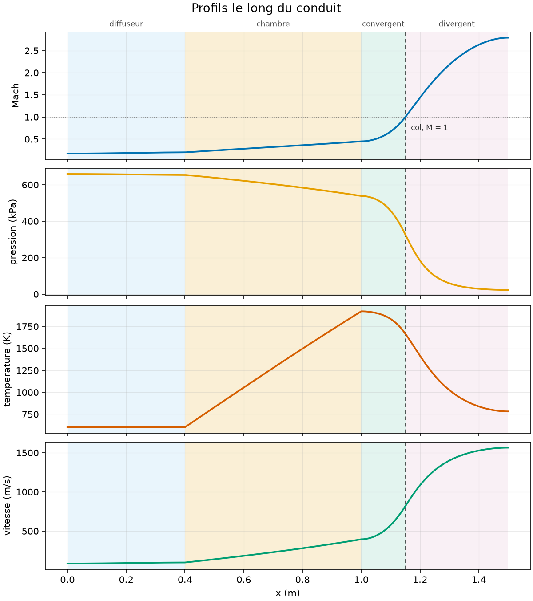
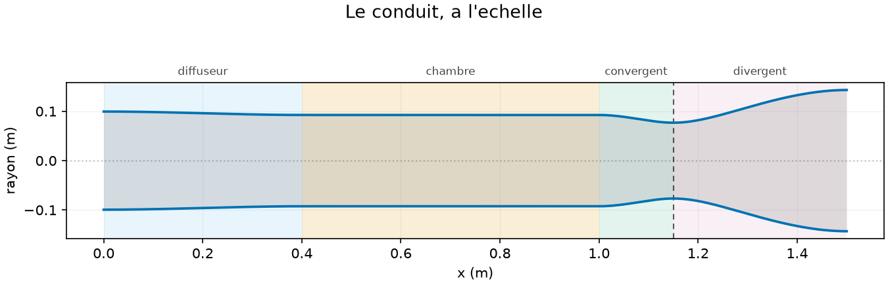
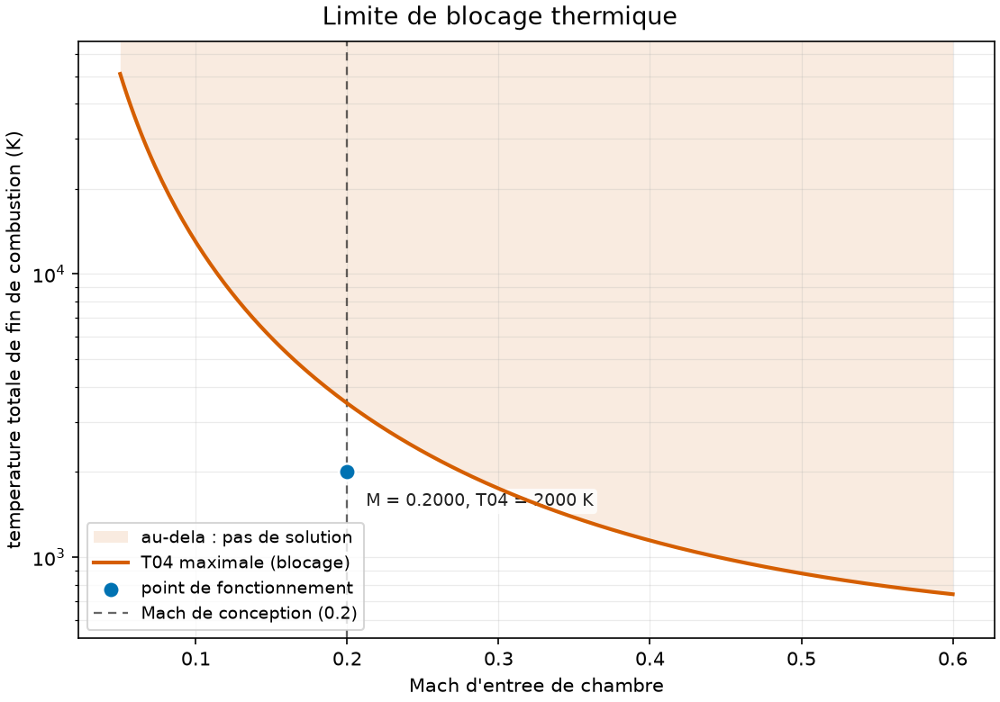
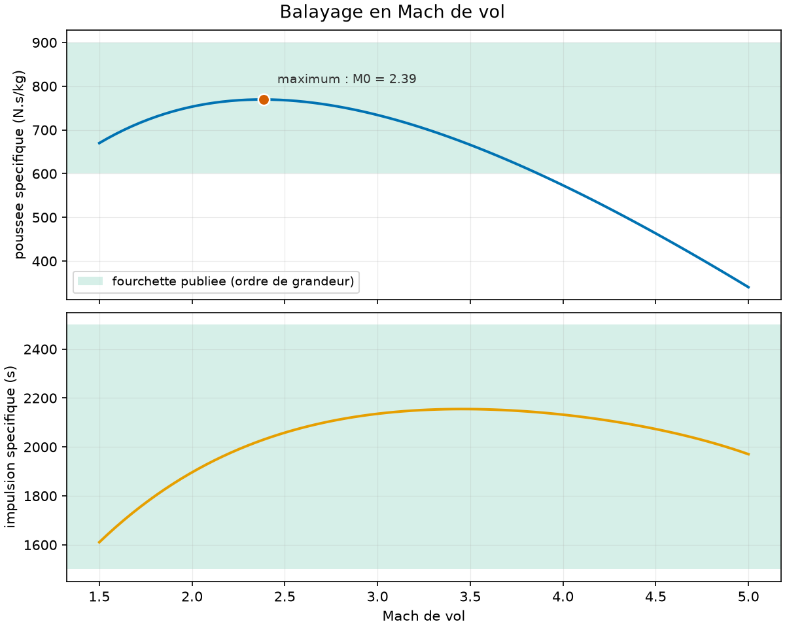
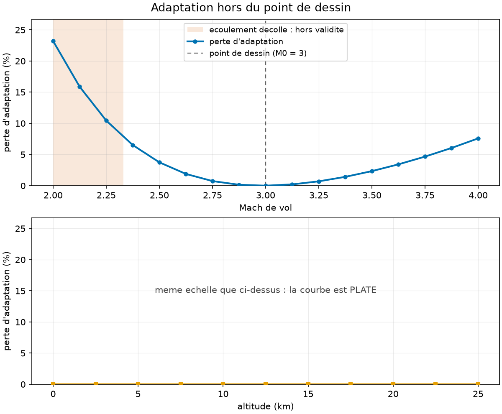

# ramjet-1d — 0D Cycle and 1D Flow of a Ramjet Engine

Two models of the same engine, written to contradict each other. The **0D** model is a station-by-station Brayton cycle: it gives specific thrust and efficiencies, and **assumes** a pressure loss in the combustion chamber. The **1D** model integrates conservation equations along the axis: it **calculates** that pressure loss—and rejects operating points that the 0D model accepts without flinching, because it accounts for thermal choking while the other ignores it.

```bash
python3 main.py
# → WHAT CAN BE TRUSTED — deviations from exact identities
# →   ok   ideal cycle vs closed form              3.33e-16   threshold 1e-12
# →   ok   momentum conservation (chamber)         1.46e-11   threshold 1e-08
# →   ok   mass conservation                       4.44e-16   threshold 1e-10
# →   ok   chamber -> nozzle interface             1.33e-15   threshold 1e-09
# →   ok   fixed point of 0D <-> 1D loop           8.58e-13   threshold 1e-10
# →   The five identities hold: the rest of the report can be read.
```

These five lines come **before** any results, in the report as well as in this document. A report that announces 737 N·s/kg upfront and relegates to an appendix the fact that an identity failed lies through sequencing, without writing a single false number.



---

## Verification and Validation, Which Are Not the Same Thing

*   **Verification** — "Am I solving the equations I wrote correctly?" Measured against **exact closed forms** with no external data. The project has three, one for each term of the equation: isentropic for area, **Rayleigh** for heat, **Fanno** for friction. Measured deviations: **1e-12 to 1e-15**.
*   **Validation** — "Do these equations describe the right engine?" Measured against published ranges. This is an **order-of-magnitude** agreement, explicitly named as such in the report.

Having an exact oracle per term is what allows us to know **which one** is wrong when a profile goes off the rails. The most useful control is none of those three: it is the **momentum balance**, which nothing in the integration forces—the ODE integrates only $M^2$, and pressure is reconstructed from mass.

---

## Installation

```bash
python3 -m venv .venv
.venv/bin/pip install -r requirements.txt
.venv/bin/python main.py --check
```

Three dependencies, strictly compartmentalized—and the compartmentalization is **tested** in a fresh subprocess:

| Library | Role | Without it |
|---|---|---|
| `numpy` | all fields are arrays | nothing runs |
| `scipy` | `solve_ivp` and events, in `solver1d.py` and `coupling.py` only | full 0D remains available |
| `matplotlib` | `plots.py` only | everything runs, without figures |

Two modules—`config.py` and `fuels.py`—do **not even import NumPy**: they are called in a loop by everything else, and importing them everywhere would be pure waste. A test scans the repository and requires **every** module to be categorized: core, 1D layer, or service. It fails on the next added file, which is the goal.

---

## Usage

```bash
python3 main.py                       # default case, full report
python3 main.py --mach 2.5 --t04 2200 # another operating point
python3 main.py --rampes 3            # 3-ramp intake instead of MIL
python3 main.py --sweep               # Mach sweep in table format
python3 main.py --validate            # + confrontation with published ranges
python3 main.py --figures             # six figures saved in sorties/
python3 main.py --check               # environment, isolation, identities
```

Exit codes: `0` ok, `1` usage error, **`2` numerical criterion not met**, `130` interrupted. An operating point rejected by physics exits with **2**, not 1: the program worked perfectly, the engine simply does not exist.

---

## The Result That Justifies the Project

The 0D model assumes $\pi_b = 0.95$ for the pressure drop in the chamber. The 1D model calculates it. We feed it back and iterate:

```
  pi_b assumed at start       0.9500
  pi_b at fixed point         0.9218   (-2.97 %)
  calls to 1D model                5
  residual |g(pi) - pi|        8.6e-13
```

**A three percent difference**—but what this correction buys is not thrust: thrust only moves by 0.2%. It is the **mass flow rate** that shifts by 2.5%, and the cross-sectional areas with it. The engine is relatively insensitive to chamber loss for what it produces, but highly sensitive for what needs to be built.

Moreover, the loop closes solely through **geometry**. At fixed duct geometry, $\pi_b$ emerges from the 1D model without depending on the input $\pi_b$—chamber data are $T_{02}$, $p_{02}$, and $T_{04}$, none of which are touched by either model—and the "loop" closes in one turn with a **strictly zero** residual.

---

## What the Assembly Taught That Neither Model Could Tell Alone

> **At fixed geometry, mass flow is not a parameter. The throat fixes it.**

A ramjet swallows what its throat lets through. Mass flow is thus the unknown of an equation—$A_*(\text{end of chamber}) = A_{\text{throat}}$—and not a given. Geometry designed for 10,000 kg/s swallows **10,351**, and the deviation is expressed in closed form: at the fixed point, $\dot{m} = \dot{m}_{\text{ref}}(1+f)$ **exactly**, with both $\pi_b$ terms canceling out. Verified to 1e-11.

Direct consequence: **the chamber never operates at design Mach.** We aim for 0.20 at the chamber inlet; the throat imposes **0.2074**. This difference is not cosmetic—it is the real Mach number that sets the thermal choking limit, and sticking to the target Mach means looking for trouble in the wrong place.



---

## The Thermal Choking Map

Heating a flow pushes its Mach number toward 1 **from both sides**. Beyond a certain heat input, no stationary solution exists: flow chokes and the air intake unstarts. This limit is **analytical**—it is the Rayleigh $T_0^*$—so there is no excuse for integrating beyond it.



The scale is logarithmic because the limit diverges as $1/M^2$: 51,000 K at $M = 0.05$ versus 700 K at $M = 0.60$. In linear scale, the entire useful zone fits in the bottom tenth of the figure.

**What an integrator unaware of this limit does** is the most instructive result of the project. At 110% of maximum heat, a fixed-step RK4 crosses $M = 1$ without a word and yields an ordinary-looking profile. By varying the step count from 500 to 8,000, the final Mach value successively yields:

| n | 500 | 1 000 | 2 000 | 4 000 | 8 000 |
|---|---|---|---|---|---|
| crossing coordinate | 0.8680 | 0.8860 | 0.8680 | 0.8672 | 0.8674 |
| **Final M** | **0.9264** | **0.7640** | **2.1088** | **1.2017** | **0.8390** |

The crossing coordinate **converges**—before the singularity, an integration remains an integration. What follows does not converge at all, and **three of these five values are subsonic**: the wrong result cannot even be recognized by its endpoint. The protected solver, by contrast, stops at $x = 0.9289\text{ m}$ and explains why.

---

## Validation Against Published Orders of Magnitude

```
    M0     pi_d      f      F/mdot     S        Isp     M9   eta_th
   1.50   0.9706  0.0424     682.9   62.11   1641.8   1.43  0.2808
   2.00   0.9250  0.0405     762.0   53.16   1918.3   1.90  0.4063
   2.50   0.8703  0.0381     774.5   49.13   2075.4   2.37  0.5092
   3.00   0.8088  0.0351     739.0   47.44   2149.6   2.81  0.5882
   3.50   0.7416  0.0315     669.7   47.06   2167.0   3.24  0.6462
   4.00   0.6695  0.0274     576.4   47.57   2143.4   3.65  0.6861
   5.00   0.5126  0.0176     342.5   51.42   1983.2   4.39  0.7103
```

Published ranges: **600–900 N·s/kg** specific thrust on $M_0$ from 2 to **3.5**, specific impulse 1,500–2,500 s. The model fits within them.



The domain stops at 3.5 rather than 4, and this is a **measured correction**: at $M_0 = 4$, the model yields 576.4 N·s/kg, below the lower bound. This is not a drift—at $T_{04} = 2,200\text{ K}$, the same point climbs back to 671.5 and re-enters the range. The validity domain depends on $T_{04}$, something the range alone does not reveal.

Two facts contained in this table that must be noted:
* specific thrust peaks at **$M_0 = 2.36$** then collapses: the higher $M_0$, the hotter incoming air arrives, leaving less margin to $T_{04}$ for burning—$f$ drops from 0.042 to 0.018;
* thermal efficiency **keeps growing** while thrust collapses. The two do not measure the same thing, and confusing them is the classic pitfall on this engine.

---

## What the Air Intake Correlation Truly Described

The entire cycle relies on a single number for the intake: $\pi_d = 0.8088$ at $M_0 = 3$, drawn from MIL-E-5008B, which describes a "well-designed" intake **without specifying which one**. By calculating recovery for real ramps, we can answer:

| intake | $\pi_d$ | $F/\dot{m}$ |
|---|---|---|
| normal shock only | 0.3283 | 580.4 |
| 2 optimal ramps | 0.7437 | 726.5 |
| **MIL-E-5008B** | **0.8088** | **739.0** |
| **3 optimal ramps** | **0.8361** | 743.8 |
| 4 optimal ramps | 0.8892 | 752.6 |

**The correlation represents a 3-ramp intake** within 3.3%—the difference being viscous losses ignored by shock theory. Moreover, the number of ramps **increases with Mach**: one ramp at $M_0 = 1.5$, three from 3 to 4, four at 5. A single number was describing a **family** of intakes.

By the way: **30% of thrust** comes from intake design.

`python3 main.py --rampes 3` runs the whole engine on a calculated intake rather than the correlation. The number of ramps belongs to the *case* and not the command line, because $\pi_d$ **varies with Mach**—a 3-ramp intake recovers 0.9966 at $M_0 = 1.5$ and 0.4306 at $M_0 = 5$—and a fixed value would be wrong across any sweep.

---

## Adaptation Is Independent of Altitude

A ramjet flies across a flight envelope, not at a single point, and its area ratio $A_9/A_{\text{throat}}$ is cast in metal. One expects off-design matching loss to vary strongly with altitude—as a rocket does, whose chamber pressure does not track ambient. **This is not the case here.**



Between 11 and 20 km, the standard atmosphere is isothermal, ram compression makes $p_{04}$ strictly proportional to ambient, and $p_9/p_{\text{amb}}$ remains **independent of altitude to the last digit**—measured deviation 1e-15 over 9 km while ambient pressure was divided by 4.5. Remaining dependence comes solely from temperature and accounts for 1% from ground to tropopause.

Against Mach number, however, the loss follows a U-curve centered at the design point: **20.9% at $M_0 = 2$**, 0.02% at $M_0 = 3$, 8.1% at $M_0 = 4$.

Both panels of the figure intentionally share the same vertical scale: stretching the bottom one would make the altitude curve "interesting" when the point to show is precisely that it is not.

**And the model was calculating a flow that does not exist.** At $M_0 = 2$, it produced a pressure term of -73% of thrust, whereas $p_9/p_{\text{amb}} = 0.246$ is well below Summerfield's separation threshold (0.4): the boundary layer separates from the divergent nozzle. Separation is a 2D viscous effect outside the scope—the model cannot calculate it, but it now **states** where it ceases to be valid, and the figure grays out that zone.

---

## Four Source Terms, Four Exact Oracles

The quasi-1D equation has four terms: area, heat, friction, and **mass addition**. Each has a closed form, allowing us to know *which one* is wrong when a profile goes off-rails:

| term | oracle | measured deviation |
|---|---|---|
| area | isentropic $A/A^*$ | 1.2e-12 |
| heat | Rayleigh | 9.8e-15 |
| friction | Fanno | 2.4e-15 |
| **mass addition** | **Rayleigh with $T_0 \propto \dot{m}^2$** | **1.2e-13** |

The last one deserves a note: the mass addition coefficient is **exactly twice** that of heat—derived from the five conservation equations and verified against an independent linear solver to **7.5e-16**. It follows that at constant $T_0$, adding mass is *exactly* equivalent to heating via Rayleigh with $T_0 \propto \dot{m}^2$, giving the fourth term an oracle as exact as the other three.

Carrying fuel inside the ODE rather than adding it afterward made three discrepancies disappear that the project had taken for physical facts: at the fixed point, inlet mass flow now equals **exactly** the design value (10.000000 kg/s), the chamber operates **exactly** at target Mach (0.200000), and off-design adaptation loss—which previously turned negative by 0.019% (thermodynamically impossible)—is positive everywhere.

---

## What Constant $cp$ Truly Costs

A complete 0D cycle with variable $cp(T)$ and $\gamma(T)$ via NASA-7 polynomials, with expansions resolved by entropy equality:

| at fixed $T_{04} = 2,000\text{ K}$ | constant $cp$ | variable $cp(T)$ |
|---|---|---|
| $f$ | 0.0351 | **0.0448** (+27.9 %) |
| $\text{Isp}$ | 2,150 s | **1,904 s** (-11.5 %) |
| $\eta_{\text{th}}$ | 0.5882 | 0.5354 (-9.0 %) |

This cycle has no oracle of its own—the three closed forms in the project assume constant $\gamma$. It is verified **by degeneration**: fed with argon, the only monatomic gas in the NASA dataset and thus with strictly constant $cp$, it must reproduce the hand-calculated constant-$cp$ cycle. Maximum deviation across six quantities: **3.1e-15**.

Then it is **validated**: the adiabatic flame temperature of kerosene in air at stoichiometric ratio from 298 K is published around 2,390 K without dissociation. The model gives **2,394 K**. The constant-$cp$ model would give 3,286 K where variable properties yield 2,598 K from $T_{02}$: **26% too high**—the difference between a plausible flame temperature and an impossible one.

---

## Known Limitations

*   **No kinetics.** Chamber length is a geometric parameter, not a reaction time. The model does not say whether combustion has time to complete, only what happens if it does.
*   **$T_{04}$ is prescribed, not calculated.** Dissociation caps actual temperature around 2,400–2,700 K; requesting $T_{04} = 3,500\text{ K}$ will output a result, and it will be wrong.
*   **The diffuser is not modeled: it is a jump.** The "diffuser" section of the profile is merely an area transition where flow **accelerates** instead of decelerating—real compression is entirely captured in $\pi_d$.
*   **1D does not carry fuel mass.** The integrated equation conserves mass: it structurally cannot carry $(1+f)$. The term is put back manually in the thrust balance, amounting to **7.4%**—exactly $f \cdot u_9$.
*   **No boundary layer**, hence no viscous choking or separation, and geometric area is identified with effective area. Friction is a constant $C_f$: it costs 0.11% of thrust here, but brings thermal choking 11% closer on an eight times longer chamber. Nozzle separation is not calculated but is **flagged** by Summerfield's criterion.
*   **Combustion is a heat and mass deposition, not chemistry.** Fuel flow enters the ODE as a fourth source term, assuming **transversal** injection—fuel arrives with zero axial momentum, which is the conservative assumption.
*   **Steady-state only.** Choking is detected as a limit of existence, which says nothing about what happens **after**—unstart is unsteady, out of scope.
*   **1D remains at constant $\gamma$, deliberately.** A 0D cycle with variable $cp(T)$ and $\gamma(T)$ exists (`run_cycle_variable`) and measures the cost: $\text{Isp}$ overestimated by **11.5%**, $f$ underestimated by 27.9%. But extending the *1D solver* to variable $\gamma$ would destroy its verification structure—its three oracles all assume constant $\gamma$. The repository chose to keep the oracles and quantify the gap.
*   **Agreement with literature is order-of-magnitude agreement.** Ranges cover engines of different designs; falling within them validates the model, it does not calibrate it.

---

## Tests

```bash
python3 -m unittest discover -s tests
# → Ran 468 tests in 223 s
```

Tests do not merely check that code runs: they record in writing what was **believed and then measured**. Several claims from the initial plan are preserved alongside the number that disproved them—coefficient $A/A^* - 1 \approx \frac{\gamma+1}{4}(M-1)^2$ recited from memory instead of the correct $\frac{2}{\gamma+1}$, two false oblique shock table values, post-singularity values that do not exist. This is the part of the repository that demanded the most work and is the most valuable.

Step-by-step details, with measurements and deviations from the initial plan, are in [`plan.md`](plan.md).