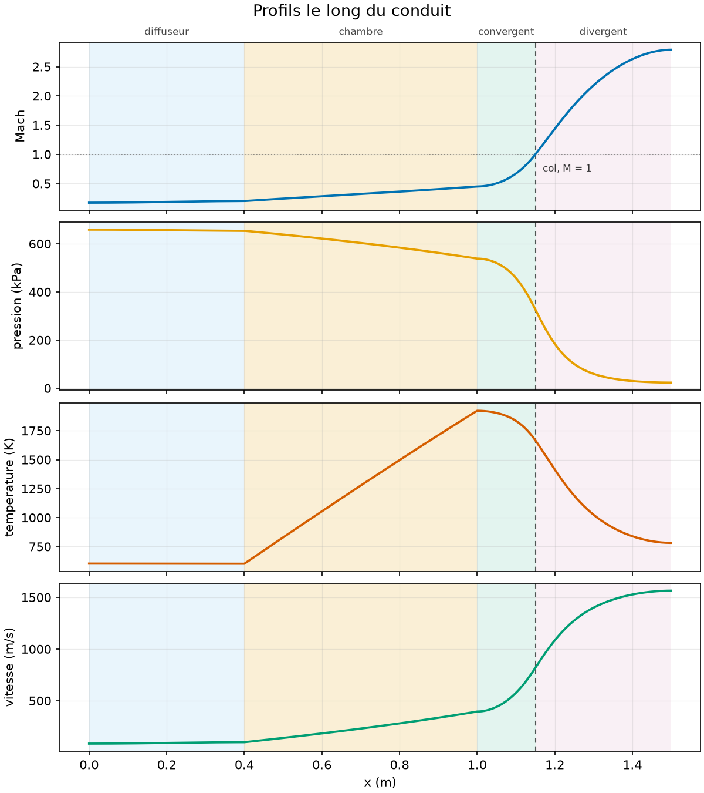
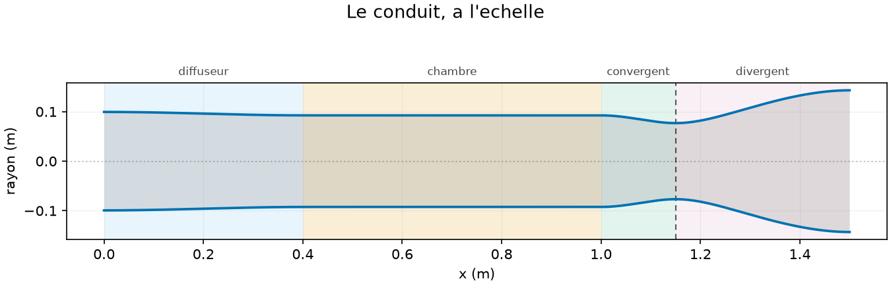
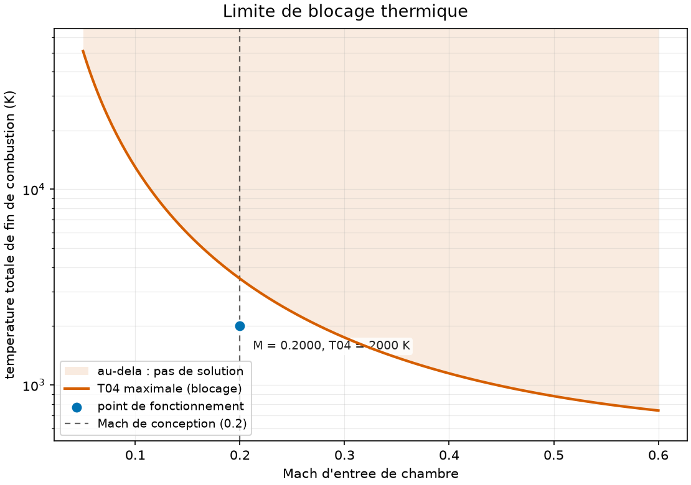
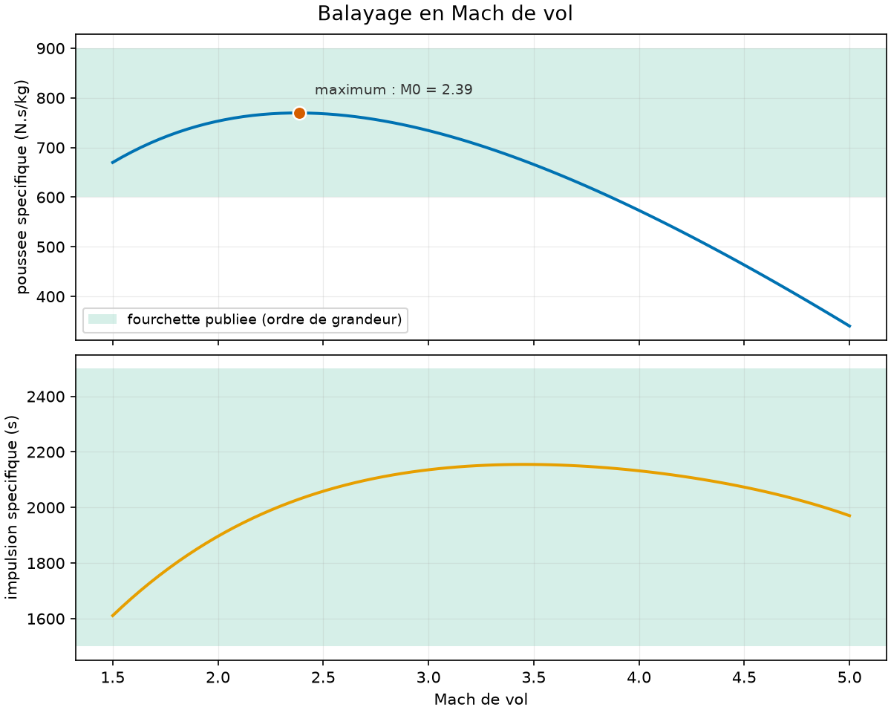
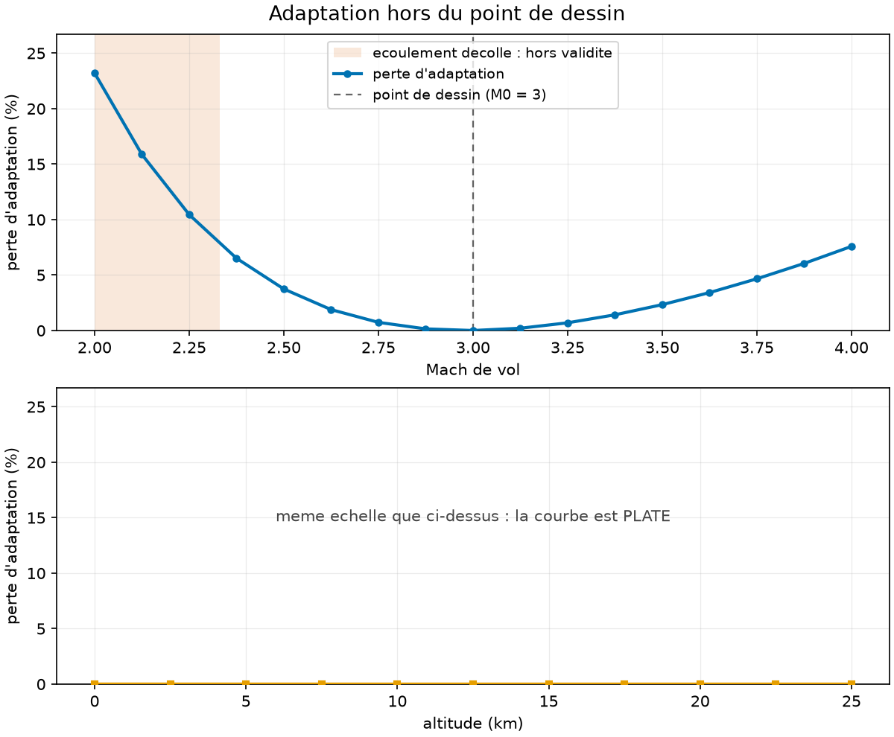

# ramjet-1d — cycle 0D et écoulement 1D d'un statoréacteur

Deux modèles du même moteur, écrits pour qu'ils se contredisent. Le **0D** est
un cycle de Brayton station par station : il donne la poussée spécifique et les
rendements, et il **suppose** une perte de pression dans la chambre. Le **1D**
intègre les équations de conservation le long de l'axe : il la **calcule** — et
il refuse des points de fonctionnement que le 0D accepte sans broncher, parce
qu'il connaît le blocage thermique et que l'autre l'ignore.

```bash
python3 main.py
# → CE QU'ON PEUT CROIRE — ecarts aux identites exactes
# →   ok   cycle ideal contre forme fermee         3.33e-16   seuil 1e-12
# →   ok   quantite de mouvement (chambre)         1.46e-11   seuil 1e-08
# →   ok   conservation de la masse                4.44e-16   seuil 1e-10
# →   ok   raccord chambre -> tuyere               1.33e-15   seuil 1e-09
# →   ok   point fixe de la boucle 0D <-> 1D       8.58e-13   seuil 1e-10
# →   Les cinq identites tombent : le reste du rapport peut etre lu.
```

Ces cinq lignes viennent **avant** le moindre résultat, dans le rapport comme
dans ce document. Un rapport qui annonce 737 N·s/kg en tête et relègue en annexe
le fait qu'une identité ne tombe pas ment par ordonnancement, sans écrire un
seul nombre faux.



---

## Vérification et validation, qui ne sont pas la même chose

- **Vérification** — « est-ce que je résous correctement les équations que j'ai
  écrites ? » On le mesure contre des **formes fermées exactes**, sans aucune
  donnée extérieure. Le projet en a trois, une par terme de l'équation :
  l'isentropique pour la section, **Rayleigh** pour la chaleur, **Fanno** pour
  le frottement. Écarts mesurés : **1e-12 à 1e-15**.
- **Validation** — « est-ce que ces équations décrivent le bon moteur ? » On le
  mesure contre des fourchettes publiées. C'est un accord d'**ordre de
  grandeur**, et le rapport le nomme ainsi.

Avoir un oracle exact par terme est ce qui permet de savoir **lequel** est faux
quand un profil déraille. Le contrôle le plus utile n'est d'ailleurs aucun des
trois : c'est le **bilan de quantité de mouvement**, que rien dans
l'intégration ne force — l'EDO n'intègre que `M²`, et la pression est
reconstruite par la masse.

---

## Installation

```bash
python3 -m venv .venv
.venv/bin/pip install -r requirements.txt
.venv/bin/python main.py --check
```

Trois dépendances, cloisonnées strictement — et le cloisonnement est **testé**,
dans un sous-processus neuf :

| Bibliothèque | Rôle | Sans elle |
|---|---|---|
| `numpy` | tous les champs sont des tableaux | rien ne tourne |
| `scipy` | `solve_ivp` et ses événements, dans `solver1d.py` et `coupling.py` seuls | le 0D complet reste disponible |
| `matplotlib` | `plots.py`, et lui seul | tout tourne, sans figures |

Deux modules — `config.py` et `fuels.py` — ne tirent **même pas NumPy** : ils
sont appelés en boucle par tout le reste, et le coût d'importation y serait pur
gaspillage. Un test parcourt le répertoire et exige que **chaque** module soit
classé : noyau, couche 1D, ou service. Il échoue au prochain fichier ajouté, ce
qui est le but.

---

## Usage

```bash
python3 main.py                       # le cas par défaut, rapport complet
python3 main.py --mach 2.5 --t04 2200 # un autre point de fonctionnement
python3 main.py --rampes 3            # entrée à 3 rampes au lieu de MIL
python3 main.py --sweep               # balayage en Mach, en table
python3 main.py --validate            # + confrontation aux fourchettes publiées
python3 main.py --figures             # les six figures dans sorties/
python3 main.py --check               # environnement, cloisonnement, identités
```

Codes de sortie : `0` ok, `1` erreur d'usage, **`2` critère numérique non
atteint**, `130` interrompu. Un point de fonctionnement refusé par la physique
sort en **2**, pas en 1 : le programme a parfaitement fonctionné, c'est le
moteur qui n'existe pas.

---

## Le résultat qui justifie le projet

Le 0D suppose `π_b = 0,95` pour la perte de pression en chambre. Le 1D la
calcule. On réinjecte, on recommence :

```
  pi_b suppose au depart      0.9500
  pi_b au point fixe          0.9218   (-2.97 %)
  appels au modele 1D              5
  residu |g(pi) - pi|        8.6e-13
```

**Trois pour cent d'écart** — mais ce que la correction achète n'est pas la
poussée : elle ne bouge que de 0,2 %. C'est le **débit** qui se déplace de
2,5 %, et les sections avec lui. Le moteur est peu sensible à la perte de
chambre pour ce qu'il produit, et très sensible pour ce qu'il faut construire.

Et la boucle ne boucle que par la **géométrie**. À conduit figé, `π_b` sort du
1D sans dépendre du `π_b` d'entrée — les données de la chambre sont `T₀₂`,
`p₀₂` et `T₀₄`, qu'aucun des deux ne touche — et la « boucle » se ferme en un
tour, avec un résidu **nul au sens strict**.

---

## Ce que l'assemblage a appris, et que ni l'un ni l'autre ne pouvait dire

> **À géométrie fixée, le débit n'est pas un paramètre. C'est le col qui le
> fixe.**

Un statoréacteur avale ce que son col laisse passer. Le débit est donc
l'inconnue d'une équation — `A*(fin de chambre) = A_col` — et pas une donnée.
La géométrie dessinée pour 10,000 kg/s en avale **10,351**, et l'écart s'écrit
en forme fermée : au point fixe, `ṁ = ṁ_réf·(1+f)` **exactement**, les deux
`π_b` se simplifiant. Vérifié à 1e-11.

Conséquence directe : **la chambre ne tourne jamais au Mach de conception.** On
vise 0,20 en entrée de chambre, le col en impose **0,2074**. Cette différence
n'est pas cosmétique — c'est le Mach réel qui fixe la limite de blocage, et s'en
tenir au Mach visé fait chercher le problème au mauvais endroit.



---

## La carte de blocage

Chauffer un écoulement pousse son Mach vers 1, **par les deux côtés**. Au-delà
d'une certaine chaleur il n'existe plus de solution stationnaire : le débit se
bloque et l'entrée d'air se désamorce. Cette limite est **analytique** — c'est
le `T₀*` de Rayleigh — donc il n'y a aucune excuse à intégrer au-delà.



L'échelle est logarithmique parce que la limite diverge en `1/M²` : 51 000 K à
`M = 0,05` contre 700 K à `M = 0,60`. En linéaire, toute la zone utile tient
dans le dixième inférieur de la figure.

**Ce que fait un intégrateur qui ne connaît pas cette limite** est le résultat
le plus instructif du projet. À 110 % de la chaleur maximale, un RK4 à pas fixe
franchit `M = 1` sans un mot et rend un profil d'allure ordinaire. En faisant
varier le nombre de pas de 500 à 8 000, le Mach final vaut successivement :

| n | 500 | 1 000 | 2 000 | 4 000 | 8 000 |
|---|---|---|---|---|---|
| abscisse de franchissement | 0,8680 | 0,8860 | 0,8680 | 0,8672 | 0,8674 |
| **M final** | **0,9264** | **0,7640** | **2,1088** | **1,2017** | **0,8390** |

L'abscisse de franchissement **converge** — avant la singularité, une
intégration reste une intégration. Ce qui suit ne converge pas du tout, et
**trois de ces cinq valeurs sont subsoniques** : le résultat faux ne se
reconnaît même pas à son point d'arrivée. Le solveur protégé, lui, s'arrête à
`x = 0,9289 m` et dit pourquoi.

---

## Validation contre les ordres de grandeur publiés

```
    M0     pi_d      f      F/mdot     S        Isp     M9   eta_th
   1.50   0.9706  0.0424     682.9   62.11   1641.8   1.43  0.2808
   2.00   0.9250  0.0405     762.0   53.16   1918.3   1.90  0.4063
   2.50   0.8703  0.0381     774.5   49.13   2075.4   2.37  0.5092
   3.00   0.8088  0.0351     739.0   47.44   2149.6   2.81  0.5882
   3.50   0.7416  0.0315     669.7   47.06   2167.0   3.24  0.6462
   4.00   0.6695  0.0274     576.4   47.57   2143.4   3.65  0.6861
   5.00   0.5126  0.0176     342.5   51.42   1983.2   4.39  0.7103
```

Fourchettes publiées : **600–900 N·s/kg** de poussée spécifique sur `M₀` de 2 à
**3,5**, impulsion spécifique 1 500–2 500 s. Le modèle y tient.



Le domaine s'arrête à 3,5 et non à 4, et c'est une **correction mesurée** : à
`M₀ = 4` le modèle donne 576,4 N·s/kg, sous la borne basse. Ce n'est pas une
dérive — à `T₀₄ = 2 200 K` le même point remonte à 671,5 et rentre dans la
fourchette. Le domaine de validité dépend de `T₀₄`, ce que la fourchette seule
ne dit pas.

Deux faits que ce tableau contient et qu'il faut lire :

- la poussée spécifique passe par un **maximum à `M₀ = 2,36`** puis s'effondre :
  plus `M₀` monte, plus l'air arrive chaud, et moins il reste d'écart à `T₀₄`
  pour brûler — `f` tombe de 0,042 à 0,018 ;
- le rendement thermique **continue de croître** pendant que la poussée
  s'effondre. Les deux ne disent pas la même chose, et les confondre est
  l'erreur classique sur ce moteur.

---

## Ce que la corrélation d'entrée d'air décrivait vraiment

Tout le cycle repose sur un seul nombre pour l'entrée : `π_d = 0,8088` à
`M₀ = 3`, tiré de MIL-E-5008B, qui parle d'une entrée « bien dessinée » **sans
dire laquelle**. En calculant la récupération de rampes réelles, on peut
répondre :

| entrée | `π_d` | `F/ṁ` |
|---|---|---|
| choc droit seul | 0,3283 | 580,4 |
| 2 rampes optimales | 0,7437 | 726,5 |
| **MIL-E-5008B** | **0,8088** | **739,0** |
| **3 rampes optimales** | **0,8361** | 743,8 |
| 4 rampes optimales | 0,8892 | 752,6 |

**La corrélation est une entrée à trois rampes**, à 3,3 % près — l'écart étant
les pertes visqueuses que la théorie des chocs ignore. Et le nombre de rampes
**croît avec le Mach** : une rampe à `M₀ = 1,5`, trois de 3 à 4, quatre à 5. Un
nombre unique décrivait une **famille** d'entrées.

Au passage : **30 % de la poussée** tiennent au dessin de l'entrée d'air.

`python3 main.py --rampes 3` fait tourner tout le moteur sur une entrée
calculée plutôt que sur la corrélation. Le nombre de rampes appartient au *cas*
et non à la ligne de commande, parce que `π_d` **varie avec le Mach** — une
entrée à trois rampes récupère 0,9966 à M₀ = 1,5 et 0,4306 à M₀ = 5 — et qu'une
valeur figée serait fausse sur tout balayage.

---

## L'adaptation ne dépend pas de l'altitude

Un statoréacteur vole sur un domaine, pas en un point, et son rapport
`A₉/A_col` est coulé dans le métal. On s'attend donc à ce que la perte
d'adaptation varie fortement avec l'altitude — c'est le cas d'une fusée, dont la
pression de chambre ne suit pas l'ambiante. **Ce n'est pas le cas ici.**



Entre 11 et 20 km, l'atmosphère standard est isotherme, la compression dynamique
rend `p₀₄` rigoureusement proportionnelle à l'ambiante, et `p₉/p_amb` s'en
trouve **indépendant de l'altitude au dernier chiffre** — écart mesuré 1e-15 sur
9 km, pendant que la pression ambiante était divisée par 4,5. Ce qui reste de
dépendance vient uniquement de la température, et vaut 1 % du sol à la
tropopause.

Contre le Mach, en revanche, la perte est en U et son fond est au point de
dessin : **20,9 % à M₀ = 2**, 0,02 % à M₀ = 3, 8,1 % à M₀ = 4.

Les deux panneaux de la figure partagent volontairement la même échelle
verticale : dilater celui du bas rendrait la courbe d'altitude « intéressante »
alors que le fait à montrer est justement qu'elle ne l'est pas.

**Et le modèle calculait un écoulement qui n'existe pas.** À M₀ = 2 il produisait
un terme de pression de −73 % de la poussée, alors que `p₉/p_amb = 0,246` est
bien sous le seuil de décollement de Summerfield (0,4) : la couche limite se
décolle du divergent. Le décollement est un effet visqueux 2D, hors périmètre —
le modèle ne peut pas le calculer, mais il **dit** maintenant où il cesse d'être
valable, et la figure grise la zone.

---

## Quatre termes source, quatre oracles exacts

L'équation quasi-1D porte quatre termes : la section, la chaleur, le frottement
et l'**apport de masse**. Chacun a sa forme fermée, ce qui permet de savoir
*lequel* est faux quand un profil déraille.

| terme | oracle | écart mesuré |
|---|---|---|
| section | isentropique `A/A*` | 1,2e-12 |
| chaleur | Rayleigh | 9,8e-15 |
| frottement | Fanno | 2,4e-15 |
| **apport de masse** | **Rayleigh avec `T₀ ∝ ṁ²`** | **1,2e-13** |

Le dernier mérite un mot : le coefficient d'apport de masse vaut **exactement le
double** de celui de la chaleur — dérivé des cinq équations de conservation et
vérifié contre un solveur linéaire indépendant à **7,5e-16**. Il s'ensuit qu'à
`T₀` constante, ajouter de la masse revient *exactement* à chauffer selon
Rayleigh avec `T₀ ∝ ṁ²`, ce qui donne au quatrième terme un oracle aussi exact
que les trois autres.

Porter le carburant dans l'EDO plutôt que de l'ajouter après coup a fait
disparaître trois écarts que le projet avait pris pour des faits physiques : au
point fixe, le débit d'entrée vaut désormais **exactement** celui du dessin
(10,000000 kg/s), la chambre tourne **exactement** au Mach visé (0,200000), et
la perte d'adaptation, qui devenait négative de 0,019 % — ce qui est
thermodynamiquement impossible — est positive partout.

---

## Ce que `cp` constant coûte vraiment

Un cycle 0D complet à `cp(T)` et `γ(T)` par les polynômes NASA-7, avec les
détentes résolues par égalité des entropies :

| à `T₀₄` = 2 000 K imposé | `cp` constant | `cp(T)` |
|---|---|---|
| `f` | 0,0351 | **0,0448** (+27,9 %) |
| `Isp` | 2 150 s | **1 904 s** (−11,5 %) |
| `η_th` | 0,5882 | 0,5354 (−9,0 %) |

Ce cycle n'a pas d'oracle à lui — les trois formes fermées du projet supposent
`γ` constant. Il se vérifie donc **par dégénérescence** : nourri d'argon, seul
gaz monoatomique du jeu NASA et donc à `cp` rigoureusement constant, il doit
reproduire le cycle à `cp` constant calculé à la main. Écart maximal sur six
grandeurs : **3,1e-15**.

Puis il se **valide** : la température de flamme adiabatique du kérosène dans
l'air, au dosage stœchiométrique depuis 298 K, est publiée autour de 2 390 K
sans dissociation. Le modèle donne **2 394 K**. Le modèle à `cp` constant
donnerait 3 286 K là où les propriétés variables donnent 2 598 K depuis `T₀₂` :
**26 % de trop** — la différence entre une température de flamme plausible et
une qui ne l'est pas.

---

## Limites connues

- **Pas de cinétique.** La longueur de chambre est un paramètre géométrique,
  pas un temps de réaction. Le modèle ne dit pas si la combustion a le temps de
  se faire, seulement ce qui se passe si elle se fait.
- **`T₀₄` est imposé, pas calculé.** La dissociation plafonne la température
  réelle vers 2 400–2 700 K ; demander `T₀₄ = 3 500 K` donnera un résultat, et
  il sera faux.
- **Le diffuseur n'est pas modélisé : c'est un saut.** Le tronçon « diffuseur »
  du profil n'est qu'un raccord de section, où l'écoulement **accélère** au lieu
  de ralentir — la vraie compression est tout entière dans `π_d`.
- **Le 1D ne porte pas la masse de carburant.** L'équation intégrée conserve la
  masse : elle ne peut structurellement pas porter le `(1+f)`. Le terme est
  remis à la main dans le bilan de poussée, et il vaut **7,4 %** — exactement
  `f·u₉`.
- **Pas de couche limite**, donc pas de blocage visqueux ni de décollement, et
  une section géométrique confondue avec la section utile. Le frottement est un
  `C_f` constant : il coûte 0,11 % de poussée ici, mais rapproche du blocage de
  11 % sur une chambre huit fois plus longue. Le décollement de tuyère n'est pas
  calculé mais il est **signalé**, par le critère de Summerfield.
- **La combustion est un dépôt de chaleur et de masse, pas une chimie.** Le
  débit de carburant entre dans l'EDO comme quatrième terme source, avec une
  injection supposée **transversale** — le carburant arrive sans quantité de
  mouvement axiale, ce qui est le cas conservateur.
- **Stationnaire seulement.** Le blocage est détecté comme une limite
  d'existence, ce qui ne dit rien de ce qui se passe **après** — le désamorçage
  est instationnaire, hors périmètre.
- **Le 1D reste à `γ` constant, délibérément.** Un cycle 0D à `cp(T)` et
  `γ(T)` existe (`run_cycle_variable`) et mesure ce que cela coûte : `Isp`
  surestimée de **11,5 %**, `f` sous-estimé de 27,9 %. Mais étendre le
  *solveur 1D* à `γ(T)` détruirait sa structure de vérification — ses trois
  oracles supposent tous `γ` constant. Le dépôt a choisi de garder les oracles
  et de chiffrer l'écart.
- **L'accord avec la littérature est un accord d'ordre de grandeur.** Les
  fourchettes couvrent des moteurs de dessins différents ; y tomber valide le
  modèle, ça ne le calibre pas.

---

## Tests

```bash
python3 -m unittest discover -s tests
# → Ran 468 tests in 223 s
```

Les tests ne vérifient pas seulement que le code tourne : ils gardent par écrit
ce qui a été **cru puis mesuré**. Plusieurs affirmations du plan initial y sont
conservées à côté du nombre qui les a démenties — le coefficient
`A/A* − 1 ≈ (γ+1)/4·(M−1)²` récité de mémoire au lieu du bon `2/(γ+1)`, deux
valeurs de tables de chocs obliques fausses, la valeur post-singularité qui
n'existe pas. C'est la partie du dépôt qui a demandé le plus de travail et c'est
celle qui vaut le plus.

Le détail étape par étape, avec les mesures et les écarts au plan initial, est
dans [`plan.md`](plan.md).
