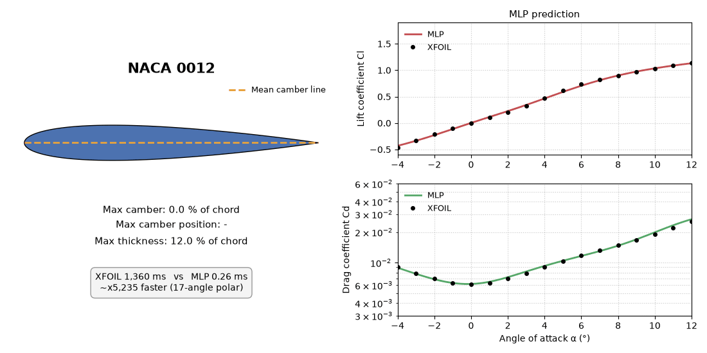
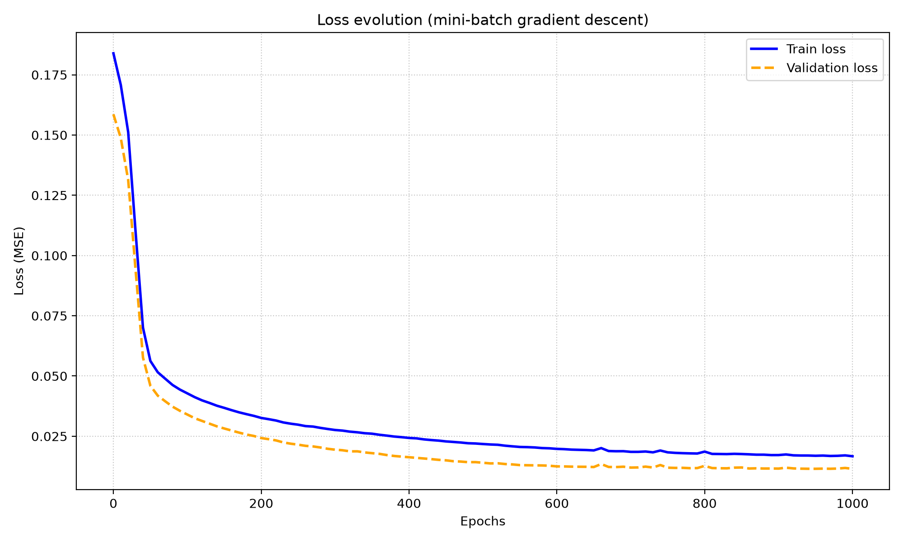
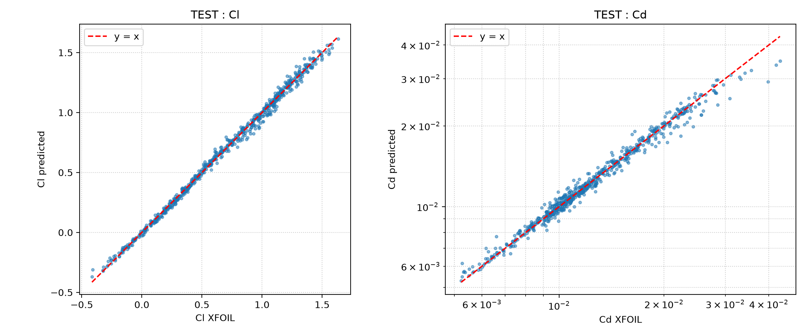

# Surrogate model for NACA 4-digit airfoils

**A neural network written from scratch in NumPy that predicts the lift and drag coefficients (Cl, Cd) of an airfoil compared to XFOIL.**



*The airfoil deforms (camber, camber position, thickness) and the network predicts Cl(α) and Cd(α) in real time. Black dots are the reference XFOIL calculations.*

## Overview

The goal of this personal project was, not only to understand a neural network by coding it myself (forward propagation, backpropagation, mini-batch gradient descent), but also to use it to build a **surrogate model** of XFOIL.

- **Dataset**: generated with XFOIL (~300 NACA 4-digit airfoils, Latin Hypercube sampling, 17 angles of attack, Re = 5·10⁵), then cleaned.
- **Inputs**: maximum camber `m`, position of maximum camber `p`, maximum thickness `t`, angle of attack `alpha`.
- **Outputs**: `Cl` and `Cd` (`Cd` is predicted as log10 to cover its order of magnitude).
- **Model**: multilayer perceptron 4 → 64 → 64 → 2 (tanh), written in pure NumPy.

## Results

Evaluated on airfoils never seen during training (the train / validation / test split is done **per airfoil**, not per point, to avoid data leakage).

| Split | Cl: R² | Cl: MAE | Cd: R² | Cd: MAPE |
|---|---|---|---|---|
| Validation | 0.9940 | 0.0204 | 0.9651 | 3.19 % |
| Test | 0.9962 | 0.0219 | 0.9710 | 3.25 % |

| Loss curve | Parity plot (test) |
|---|---|
|  |  |

**Speed** (one polar of 17 angles, mean over 5 airfoils, single run, Intel MacBook Pro, CPU only):

| | Time per polar |
|---|---|
| XFOIL | ~1.4 s |
| MLP | ~0.3 ms |

This is a speed-up of the order of 4,000x or more. It comes from a single run of `bench_time.py`, so treat it as an order of magnitude and re-run it on your machine.

**Other observations**

- Validation and test errors are almost identical, so the model generalises to unseen airfoils.
- Switching from full-batch to mini-batch gradient descent reduced the Cd MAPE from 7.7 % (3,000 epochs) to 3.2 % (1,000 epochs) on validation.
- The model slightly underestimates high drag values (Cd ≳ 0.03), close to stall.
- The hand-written backpropagation was checked against finite differences (relative error ~1e-10 on randomly chosen weights of the first layer).

## Pipeline

1. **Generate the data** (`generate.py`): Latin Hypercube sampling of `(m, p, t)` with `m ∈ [0, 0.06]`, `p ∈ [0.2, 0.6]`, `t ∈ [0.06, 0.24]`; XFOIL is run for `alpha` from −4° to 12° (step 1°) at Re = 5·10⁵. Output: `data_raw.csv`, `data_clean.csv` (basic filtering).
2. **Clean the data** (`clean_v2.py`): an airfoil is removed **entirely** if any of its points fails a test:
   - Cd outside [0.002, 0.05] or |Cl| > 2;
   - Cl not increasing with alpha before stall (alpha ≤ 6°);
   - Cd jumping by more than a factor 4 between two consecutive angles.

   Result: 15 of 298 airfoils removed (5 %), leaving **283 airfoils and 4,600 points** in `data_clean_v2.csv`.
3. **Train and evaluate** (`main.py`, built on the model code in `my_MLP_numpy.py`): standardisation (statistics computed on the training set only), Xavier initialisation, MSE loss, mini-batch gradient descent (batch size 64, learning rate 0.01, 1,000 epochs), 70 / 15 / 15 split per airfoil.
4. **Animate** (`animate.py`) and **benchmark** (`bench_time.py`).

Columns of the dataset: `profile_id, m, p, t, alpha, Re, Cl, Cd`.

## Repository structure

```
.
├── generate.py          # LHS sampling + XFOIL runs -> data_raw.csv, data_clean.csv
├── clean_v2.py          # per-airfoil cleaning -> data_clean_v2.csv
├── naca.py              # NACA 4-digit coordinates
├── main.py              # entry point: gradient check, training, evaluation, plots, saves the weights
├── my_MLP_numpy.py      # model code: data preparation, MLP, training, evaluation, plots (imported by main.py)
├── animate.py           # GIF: morphing airfoil, MLP prediction vs XFOIL points
├── xfoil_overlay.py     # XFOIL reference points for the animation (cached)
├── bench_time.py        # XFOIL vs MLP timing
├── plot_polaire.py      # Cd(alpha) of random airfoils from the dataset
├── test_xfoil.py        # quick check that the XFOIL module works
├── data_clean_v2.csv    # cleaned dataset
├── profils_retires.csv  # ids of the airfoils removed by the cleaning
├── mlp_numpy_v2.npz     # trained weights and standardisation statistics
├── xfoil_cache.npz      # cached XFOIL polars used by the animation
├── bench_result.json    # timing results used by the animation
├── requirements.txt
└── README.md
```

## Installation

Python 3.11 was used.

```bash
python -m venv env
source env/bin/activate
pip install -r requirements.txt
```

**XFOIL** is only needed to regenerate the dataset (`generate.py`), the animation reference points from scratch, or the timing benchmark. It is **not** needed to train the model from `data_clean_v2.csv`, or to rebuild the GIF from the provided `xfoil_cache.npz`.

The `xfoil` Python module is a compiled extension: it needs `cmake` and a Fortran compiler (e.g. `brew install gcc cmake` on macOS). The package on PyPI is incomplete, so `requirements.txt` installs it from GitHub. On macOS with Anaconda, if the build fails with a linker error such as `unsupported tapi file type`, put Apple's linker first in the path before installing:

```bash
export PATH=/usr/bin:$PATH
pip install -r requirements.txt
```

## Usage

```bash
python generate.py        # optional: regenerate the dataset (needs XFOIL, ~10 minutes)
python clean_v2.py        # optional: re-run the cleaning
python main.py            # gradient check, training, evaluation, loss curve, parity plot, saves the weights
python animate.py         # build naca_morph.gif (needs mlp_numpy_v2.npz)
python plot_polaire.py    # optional: Cd(alpha) of random airfoils from the dataset
python test_xfoil.py      # optional: check that the XFOIL module works
python bench_time.py      # XFOIL vs MLP timing (needs XFOIL)
```

All random seeds are fixed (sampling, split, weight initialisation, mini-batch shuffling), so training should reproduce the figures above, up to small floating-point differences between machines.

## Limitations

- Valid only for **NACA 4-digit airfoils, Re = 5·10⁵ and α ∈ [−4°, 12°]**. Outside this domain, XFOIL (or better) remains the reference.
- The surrogate learns **XFOIL**, not experiments or CFD, so it inherits XFOIL's errors, particularly near stall.
- Small dataset (283 airfoils) and a single train / validation / test split: no cross-validation, no confidence intervals.
- The timing comparison is a single run on one machine.

## Possible extensions

- Add the Reynolds number (and Mach number) as inputs.
- Move to arbitrary airfoils with a CST parameterisation.
- Use the surrogate for shape optimisation.
- Compare with a PyTorch implementation and with NeuralFoil.

## References

- M. Drela, *XFOIL: An Analysis and Design System for Low Reynolds Number Airfoils*, 1989.
- [XFOIL Python module](https://github.com/DARcorporation/xfoil-python) (DARcorporation).